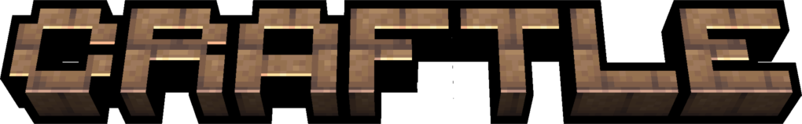
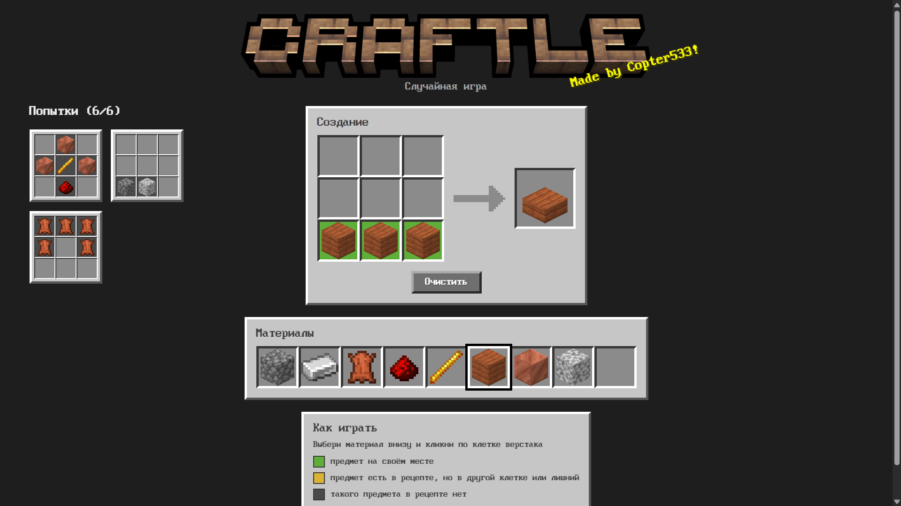

<p align="center">
  
</p>

<p align="center">
  <b>Wordle, только про крафт в Minecraft.</b><br>
  Угадай рецепт по цветным подсказкам — за ограниченное число попыток.
</p>

<p align="center">
  
</p>

---

## Как играть

Тебе загадан рецепт верстака, но сам предмет не показан. Выбирай материалы из палитры, раскладывай их по сетке 3×3 и кликай по слоту результата, чтобы проверить догадку. Попытка должна быть настоящим рецептом.

После каждой попытки клетки окрашиваются:

| | Значение |
|---|---|
| 🟩 | предмет на своём месте |
| 🟨 | предмет есть в рецепте, но в другой клетке (или он лишний) |
| ⬛ | такого предмета в рецепте нет |

Сервер умеет **ежедневную игру** — одну на всех в течение дня — и **случайные игры** с уровнями сложности от лёгкого до экстремального.

## Что внутри

- **Рецепты и текстуры берутся прямо из файлов игры.** Парсер разбирает JSON рецептов, теги (`#minecraft:planks`) и списки альтернатив: сундук собирается из любых досок, в том числе разных.
- **Честная проверка рецептов.** Рецепты с формой проверяются со всеми сдвигами и зеркальным отражением, бесформенные — по количеству предметов в каждой группе альтернатив. Подсветка выбирает расположение с максимумом зелёных клеток.
- **Генератор головоломок с подсчётом вероятностей.** Палитра собирается из ингредиентов ответа и рецептов-приманок, соседних по графу крафта. Каждый вариант палитры проверяют два смоделированных игрока:
  - *«умный»* выбирает самую информативную попытку и гарантирует, что игру вообще можно решить;
  - *«обычный»* пробует случайный рецепт, не противоречащий подсказкам. По нему точно (без Монте-Карло) считается **шанс победы**, и сложность настраивается именно им.
- **3D-рендер предметов на чистом CSS.** Модели блоков (ступеньки, заборы, стены, кнопки, ковры…) собираются из элементов модели игры: цепочка родителей, UV-развёртка, повороты, окраска травы и листвы, анимированные текстуры.
- **Подсказки с русскими названиями** предметов из языковых файлов игры.
- **Бэкенд:** игрок опознаётся по cookie, частые запросы ограничиваются (rate limit), кэш результатов крафта на клиенте.

## Технологии

**Бэкенд:** Python, FastAPI, Pydantic, slowapi
**Фронтенд:** чистые HTML, CSS и JavaScript — без фреймворков и сборщиков
**Тесты:** pytest

```
recipes.py      — разбор рецептов, проверка сетки, раскраска попыток
game_gen.py     — генератор головоломок: граф крафта, симуляция игроков, сложности
main.py         — FastAPI: API игры, рендер-данные предметов, раздача статики
static/         — фронтенд: index.html, style.css, app.js, render.js (3D-рендер)
tests/          — тесты рецептов (в том числе каверзные случаи)
```

## Запуск

Нужен **Python 3.12+** и установленный **Minecraft: Java Edition**.

**1. Зависимости**

```bash
pip install -r requirements.txt
```

**2. Файлы игры**

Ассеты Minecraft принадлежат Mojang и в репозиторий не входят — их нужно взять из своей копии игры и положить в папку `mc_resources/`:

1. Открой архиватором (например, 7-Zip) файл `.minecraft/versions/<версия>/<версия>.jar` — это обычный zip-архив.
2. Скопируй содержимое `assets/minecraft/` в `mc_resources/assets/`, а содержимое `data/minecraft/` — в `mc_resources/data/`.
3. Русские названия лежат не в jar, а в общей папке ресурсов: в `.minecraft/assets/indexes/<номер>.json` найди запись `minecraft/lang/ru_ru.json`, возьми её `hash` и скопируй файл `.minecraft/assets/objects/<первые 2 символа хеша>/<хеш>` как `mc_resources/assets/lang/ru_ru.json`.

Должно получиться так:

```
mc_resources/
├── assets/
│   ├── items/  models/  textures/
│   └── lang/ru_ru.json
└── data/
    ├── recipe/
    └── tags/item/
```

**3. Сервер**

```bash
python main.py
```

Игра откроется на http://127.0.0.1:5500.

Для ежедневной игры можно задать свою «соль», чтобы ответ нельзя было вычислить заранее: переменная окружения `CRAFTLE_SALT`.

## Тесты

```bash
python -m pytest
```

Тесты, которым нужны файлы игры, автоматически пропускаются, если папки `mc_resources/` нет.

---

<sub>NOT AN OFFICIAL MINECRAFT PRODUCT. NOT APPROVED BY OR ASSOCIATED WITH MOJANG OR MICROSOFT.<br>
Это некоммерческий фанатский проект. Minecraft — торговая марка Mojang Synergies AB.</sub>